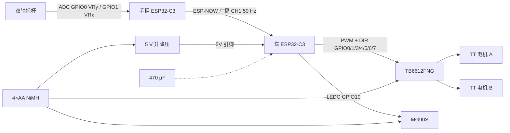

# ESP32-C3 阿克曼遥控车

两块 ESP32-C3 SuperMini：手柄读摇杆 ADC，经 ESP-NOW 广播（信道 1，20 ms / 50 Hz）控制小车。底盘为阿克曼，后轮驱动（TB6612FNG + 两路 1:48 TT 电机，同速），前轮 MG90S 舵机转向。小车超过 300 ms 收不到合法包则油门/转向回零。

固件分两个 ESP-IDF 工程：`car/`（接收端 + 电机/舵机）与 `remote/`（发送端）。TB6612 驱动在 `car/components/tb6612/`。

## 系统框图



## BOM

| 数量 | 物料 |
|------|------|
| 2 | ESP32-C3 SuperMini（焊接版） |
| 1 | TB6612FNG 电机驱动模块 |
| 2 | 1:48 TT 减速电机（带焊线） |
| 1 | 阿克曼底盘套件（带舵机座） |
| 1 | MG90S 舵机 |
| 1 | 4 节 AA 电池盒 + 4 节 AA 镍氢电池 |
| 1 | 5 V 升降压模块 |
| 1 | 470 µF 电解电容 |
| 1 | 双轴摇杆模块 |
| 1 | 充电宝 / USB 电源（给手柄供电） |
| 2 | 面包板 |
| — | 杜邦线 |
| 1 | 能传数据的 Type-C 线 |

## 接线

所有模块共地。不要用 GPIO2 / 8 / 9（strapping）和 GPIO18 / 19（USB）。

### 车

| 功能 | ESP32-C3 GPIO | 对端 |
|------|---------------|------|
| PWMA | 0 | TB6612 PWMA |
| AIN1 | 1 | TB6612 AIN1 |
| AIN2 | 3 | TB6612 AIN2 |
| PWMB | 4 | TB6612 PWMB |
| BIN1 | 5 | TB6612 BIN1 |
| BIN2 | 6 | TB6612 BIN2 |
| STBY | 7 | TB6612 STBY |
| 舵机信号 | 10 | MG90S SIG |

- TB6612 VCC → SuperMini 3V3；VM → 电池正极。
- 电机 A → AO1 / AO2；电机 B → BO1 / BO2。
- 舵机电源接电池（与 VM 同组），信号接 GPIO10。

### 手柄

| 功能 | ESP32-C3 GPIO | 对端 |
|------|---------------|------|
| 油门 | 0 | 摇杆 VRy |
| 转向 | 1 | 摇杆 VRx |

摇杆 VCC 接 SuperMini 3V3，不要接 5 V。GND 共地。

## 供电

- 4×AA 镍氢直接给 TB6612 VM 和 MG90S。
- 同一组电池经 5 V 升降压模块接到车端 SuperMini 的 5V 引脚；C3 电源脚并 470 µF 电解电容。
- 若 C3 频繁复位，改用充电宝单独给 C3 供电（电机/舵机仍走电池）。
- 不要用 6 节 AA（约 9 V，TT 电机易过热）。
- 手柄用充电宝或 USB 供电。

## 编译烧录

ESP-IDF v5.5.x，目标 `esp32c3`。控制台走 USB Serial/JTAG。

```bash
cd car   # 或 remote
idf.py set-target esp32c3
idf.py -p /dev/ttyACM0 flash monitor
```

认不到端口：按住 BOOT，再按一下 RST，松开 BOOT 后重试。手柄上电时不要碰摇杆（开机采样 64 次做中位校准）。

## 上车调试

改完宏后重新编译烧录。

| 宏 | 位置 | 作用 |
|----|------|------|
| `MOTOR_A_INVERT` / `MOTOR_B_INVERT` | `car/main/main.c` | 某一后轮方向反了就置 1 |
| `SERVO_TRIM` | `car/main/main.c` | 中位偏置（µs），舵机不居中时微调 |
| `SERVO_RANGE_US` | `car/main/main.c` | 满舵相对中位的脉宽幅度；先用 400，避免打到机械限位 |
| `INVERT_THR` / `INVERT_STR` | `remote/main/main.c` | 油门/转向轴方向反了就置 1 |

## 状态

已通过 `idf.py build`（target esp32c3，ESP-IDF v5.5）。尚未上实物验证。
